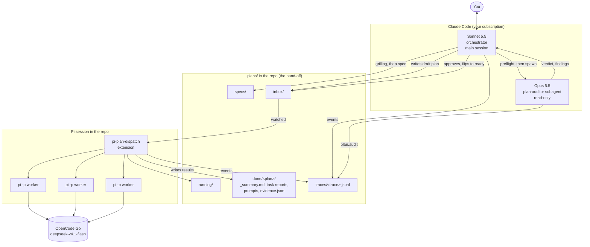
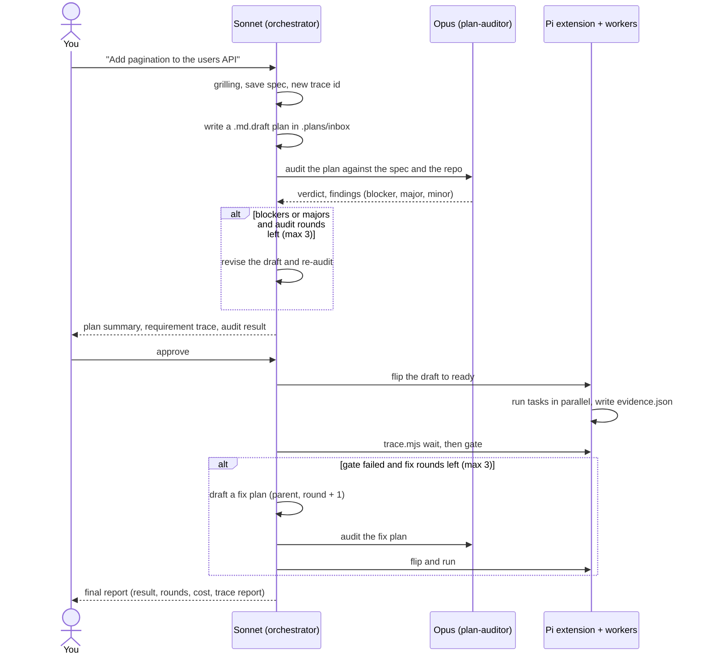

# Pi Harness: pi-plan-dispatch

Plan with Claude, review the plan with Opus, implement with cheap models, and keep a trace of every step.

You talk to one Claude Code session, Sonnet 5.5, which clarifies the request into a saved spec and writes the plan. Opus 5.5 checks the plan before any worker runs. A Pi extension then fans the tasks out to cheap workers (DeepSeek V4.1 Flash on OpenCode Go), and the gate, the `verify:` commands and the live guards check the result. Every run leaves evidence on disk: what each worker was told, what it did, what actually changed, and whether the gate passed.

## Why

- **No manual hand-offs.** You stay in Claude Code. Files under `.plans/` carry work between tools.
- **Cheap where it counts.** Workers do the bulk of the typing on an OpenCode Go subscription. Claude models stay on your Claude subscription and are never routed through Pi.
- **Checked work.** Opus checks the plan before any worker runs, and the gate, the `verify:` commands and the guards check what the workers produced.
- **Traceable.** One trace per request, linked across fix rounds, with evidence that does not rely on what a worker says about itself.

## The rule

Claude models, Sonnet and Opus included, never write code, tests, scripts, config or docs in the repository. The orchestrator writes only artifacts under `.plans/`: the spec, the plans and the traces. It never commits. There is no break-glass switch yet; an enforcing hook is planned, so for now it is a rule.

## Architecture



Full picture, including the planned agent-vault, Graphify and permissions hook: [docs/architecture.md](docs/architecture.md).

### Roles

| Role | Model | Where it runs | Job |
|---|---|---|---|
| Orchestrator | Sonnet 5.5 | Claude Code main session | Talks to you, clarifies with the `grilling` skill into a spec, writes the plan, runs the plan audit, gets your approval, waits and reports the gate. Writes only under `.plans/`. |
| `plan-auditor` | Opus 5.5 | `plan-auditor` subagent | Fresh-context, read-only review of the plan against the spec and the repo. Returns a verdict and severity-tagged findings. Never reviews worker results. |
| Workers | DeepSeek V4.1 Flash (default) | headless `pi` processes started by the extension | Implement one task each, inside the files the plan gave them. |

You talk to the orchestrator directly, and it can ask you questions itself. The one subagent it spawns, `plan-auditor`, is read-only and never needs to ask you anything.

These two Claude-side roles are separate from the worker roles (`implement`,
`security`, `qa`, and read-only pair reviewers such as `review`) that plans name and
`.plans/config.json` maps to cheap models. See [docs/roles.md](docs/roles.md) for the
worker role model.

## How a request flows



1. **Spec.** Sonnet clarifies the request with the `grilling` skill and saves `.plans/specs/<trace>.md` with numbered requirements. You confirm it, and Sonnet logs `spec.confirmed`.
2. **Plan.** Sonnet writes `.plans/inbox/<trace>-r1.md.draft` with `status: draft`, naming the spec and starting every task with `Covers: R1, R2`. Every draft, round 1 and fix rounds, is written this way.
3. **Preflight and plan audit.** The preflight CLI checks the plan with the dispatcher's own parsing. Then Opus runs as the read-only `plan-auditor` subagent, reviews the plan against the spec and the repo, and returns `[blocker]`, `[major]` and `[minor]` findings with a verdict. Sonnet revises and re-audits, at most 3 audit rounds, then asks you.
4. **Approve.** In pilot mode Sonnet shows you the plan, the requirement-to-task trace and the audit result, and asks for approval. Only after you say yes does it log `plan.approved` and flip the draft to `ready`.
5. **Run.** The extension picks up the ready plan and runs tasks as their dependencies finish, never running two tasks whose `files:` overlap at the same time.
6. **Gate.** When the plan ends, the extension writes `evidence.json`. The gate passes only if every task is done and there are no error faults. Opus does not review the result; the gate, the `verify:` commands, the live guards and pair review do.
7. **Fix.** On a failed gate, Sonnet drafts a fix plan from the evidence and takes it through preflight, plan audit and your approval again, up to 3 fix rounds (the last plan id ends in `-r4`). A repeated finding stops the loop and goes back to you.

## Install

Requirements: [Pi](https://pi.dev) 1.3.0 or newer (`@earendil-works/pi-coding-agent`) and logged into OpenCode Go (`pi` then `/login`, or `OPENCODE_API_KEY`). Sonnet 5.5 is the Claude Code main session.

```bash
# 1. The Pi extension (pick one)
pi install ./pi-plan-dispatch                        # as a package
cp -r pi-plan-dispatch ~/.pi/agent/extensions/       # or as a global extension

# 2. The Claude Code skill runtime files (also the trace CLI and the preflight CLI)
mkdir -p ~/.claude/skills/dispatch-plan && cp dispatch-plan/SKILL.md dispatch-plan/ORCHESTRATOR.md dispatch-plan/trace.mjs dispatch-plan/preflight.mjs dispatch-plan/config-init.mjs ~/.claude/skills/dispatch-plan/

# 3. The plan-auditor agent
mkdir -p ~/.claude/agents && cp dispatch-plan/agents/plan-auditor.md ~/.claude/agents/

# 4. If you installed an earlier version, remove the two superseded agents
rm -f ~/.claude/agents/planner.md ~/.claude/agents/auditor.md

# 5. Orchestrator rules: paste the block from dispatch-plan/ORCHESTRATOR.md
#    into the project's CLAUDE.md, then set the main session to Sonnet 5.5
```

Copy the runtime files by name: the `dispatch-plan/` folder also holds `archive/` and the tests, which must not be installed. The installed skill folder must be refreshed after pulling changes, because `trace.mjs` and `preflight.mjs` are called from `~/.claude/skills/dispatch-plan/`; a missing module means a stale install.

Add `.plans/` to `.gitignore`. After updating the extension, run `/reload` in Pi or restart it: a running Pi keeps the old code in memory.

## Use

1. Open Pi in the repo and leave it running. The footer shows `plans: watching`.
2. In Claude Code, ask for the work. Sonnet is the orchestrator and asks you questions directly. Confirm the spec, review the plan and the audit result, and approve.
3. Read the final report. The gate result, the rounds, the cost and the trace report path are in it.

Commands inside Pi:

| Command | What it does |
|---|---|
| `/plans` | Status: running plan, queue, worker settings |
| `/plans dry on` / `off` | Simulate workers (no model calls), handy for testing |
| `/plans stop` | Abort the running plan |
| `/plans scan` | Re-scan the inbox now |
| `/plans roles` | List each role's model, thinking level and read-only flag |
| `/plans roles test` | Run a tiny real call for every model the roles use |
| `pi --plans-dry-run` | Start in dry-run mode |

## Plan format

```markdown
---
id: <trace>-r1
trace: <trace>          # shared by every plan of one request
spec: .plans/specs/<trace>.md  # the saved spec this plan implements
round: 1                # +1 per fix round
parent: <plan id>       # fix rounds only: the plan this one follows up
status: draft           # draft is ignored; ready is picked up
max_parallel: 3         # optional
verify: npm test
---
Shared context every worker needs: goal, conventions, interfaces, test command.

## task: api
files: src/api/users.ts, src/api/users.test.ts
depends_on: []
verify: node --test src/api/users.test.ts
Covers: R1, R3.         # first body line: the spec requirements it implements
Instructions for a capable but context-free engineer.

## task: ui
files: src/ui/
depends_on: [api]
thinking: high          # optional per-task override (also: model)
role: implement         # optional, default implement
pair: review            # optional: a read-only role reviews before the task is done
pair_rounds: 2          # optional, 1-3
...
```

- `spec:` is the saved spec at `.plans/specs/<trace>.md`. Every task starts its body with a `Covers: R1, R2.` line naming the requirements it implements; the parser ignores it, and the `plan-auditor` checks it.
- `files:` lists every path a task may edit. A directory covers everything under it. A task with no `files:` runs alone.
- `depends_on:` holds task ids that must finish first. If a dependency fails, its dependents are skipped.
- `role:` names the job a task does: `implement` (default), `security`, `qa`, or one you configured. Only `security` may be a read-only task role; `review` and every other read-only role are `pair:` reviewers, and a custom read-only role works the same way. `pair:` adds a read-only reviewer that reviews the task before it counts as done: `changes` sends the implementer back with the findings, while `issues` ends the loop at once and leaves its findings for the orchestrator's report to you. `pair_rounds:` (1-3, default 2) bounds that loop. Plans never hard-code model names. See [docs/roles.md](docs/roles.md).
- `verify:` is a shell command the dispatcher runs itself, not the worker. A task-level `verify:` runs right after a successful attempt and gates that task's retry; the plan-level one runs once after every task is done and gates the plan. Scope each one to the task's own files so a parallel worker's half-finished edits cannot break it.
- Preflight rejects a plan before any worker starts when a `files:` entry is absolute, contains `..`, or points inside `.git/` or `.plans/`; a task lists more than 10 files (`maxFilesPerTask`); a task body is longer than 8000 chars (`maxTaskChars`); or a `verify:` executable cannot be found.
- Write the draft as `.<id>.md.draft.tmp` and `mv` it to `.plans/inbox/<id>.md.draft`, so the extension never reads a half-written plan. The dispatcher reads only `*.md` files, so a draft with `status: draft` is ignored; the flip command in `dispatch-plan/SKILL.md` makes a plan ready, and it is the only way to do so.
- A malformed plan (unknown dependency, cycle, no tasks) moves to `.plans/failed/` with an `.error.md` explaining why. Fix it, redraft it as `.plans/inbox/<id>.md.draft` with `status: draft`, get approval and flip it again under the same id; the extension clears the old rejection files.

In pilot mode the orchestrator shows you the plan, the requirement-to-task trace and the audit result, and asks for approval. Only after you say yes does it flip the draft with this command, which edits only the frontmatter and stops if no `status: ready` line results:

```bash
sed -E '2,/^---$/ s/^status:[[:space:]]*draft([[:space:]]+#.*)?[[:space:]]*$/status: ready/' .plans/inbox/<id>.md.draft > .plans/inbox/.<id>.md.tmp && grep -q '^status: ready$' .plans/inbox/.<id>.md.tmp && mv .plans/inbox/.<id>.md.tmp .plans/inbox/<id>.md && rm .plans/inbox/<id>.md.draft
```

The `.plans/config.json` key `autoReady` is `false` by default, and the orchestrator never enables it. If the user turns it on, a clean plan audit may flip the plan without asking, still logging `plan.approved` with `approved_by: "autoReady"`.

## Tracing and the gate

One **trace** is one user request across all rounds. The orchestrator, the `plan-auditor` and the extension all append events to `.plans/traces/<trace>.jsonl`. Spans link by `parent`: task to plan, plan audit to plan, fix plan to the plan it follows. The event-level `round` is always the plan round, the number in the plan id; the audit counter lives in `plan.audit` data as `audit_round`.

| Who | Events |
|---|---|
| Orchestrator | `spec.confirmed`, `plan.drafted`, `plan.approved`, `loop.stop` |
| `plan-auditor` | `plan.audit` (`verdict`, `audit_round`, `blockers`, `majors`, `minors`, `summary`); nobody else writes it |
| Extension | `plan.received`, `plan.rejected`, `task.start` (data gains the task's `role`), `task.end`, `task.verify`, `task.review` (a pair or security review), `fault`, `gate`, `plan.end` |

`audit.verdict` is legacy: the result audit it recorded no longer exists, so nothing writes it, but the report still renders old traces that contain it.

Per finished plan, `.plans/done/<plan>/` holds:

| File | What |
|---|---|
| `plan.md` | The plan as it ran |
| `_summary.md` | Gate line, fault list, task table, cost |
| `<task>.md` | The worker's report |
| `<task>.prompt.md` | The exact prompt the worker received |
| `<task>.verify.md` | The task's `verify:` command, outcome and output tail |
| `plan.verify.md` | The plan-level `verify:` result |
| `evidence.json` | Changed files, faults, gate, verification, pair results and reviewer reports |

**Evidence has three sources**, in decreasing order of trust: Pi's tool-call stream (which tool touched which path), a git snapshot before and after the plan (which files actually changed), and the worker's own report. The extension compares them and raises faults where they disagree.

| Fault | Severity | Meaning |
|---|---|---|
| `task_failed` | error | A worker failed after its retries |
| `out_of_scope_edit` | error | A worker edited outside its `files:` |
| `unowned_change` | error | A file changed that no task owns; not raised when some task has no `files:` |
| `task_skipped` | warn | A dependency failed, or the plan was stopped |
| `report_malformed` | warn | The final report is missing required sections |
| `claimed_not_changed` | warn | Reported as changed, but no edit was seen |
| `unreported_change` | warn | Changed, but missing from the report |
| `no_op_done` | warn | Marked done with no edit and no change in its files |
| `tests_not_run` | warn | The task names tests or checks, but the report says none |
| `verify_failed` | error | A `verify:` command failed or timed out, per task or for the plan |
| `blocked_action` | warn | The live guard blocked a worker's tool call |
| `edit_unread_file` | warn | A pre-existing file was edited without being read first |
| `security_finding` | error / warn / info | A security review finding; high is an error, medium a warning, low info |
| `pair_unresolved` | warn | Pair rounds ran out, or `maxRunsPerTask` was reached, with findings still open, or an `issues` verdict ended the loop |
| `review_unparsed` | warn | A pair or security reviewer returned no readable verdict |
| `readonly_violation` | error | A read-only task edited something. The guard denies edit tools and obvious shell writes; the window around its own run or its pair reviewer's run catches what it misses, blaming a changed file unless a task running concurrently owns it |
| `retried` | info | Succeeded after one or more failed attempts; a pair re-run does not count as a retry |

The **gate** passes only when every task is done and there are zero error faults. A dry run never passes.

## Guardrails

Workers' claims are not trusted, and four guardrails check them.

- **Independent verification.** A task or the plan may name `verify: <shell command>`. The dispatcher runs it with `sh -c` in the repo root after a worker reports success (exit 0 = verified). A failure or timeout retries the task with the output as feedback, or fails it, and a failing plan-level check fails the gate. The runs are serialised by a lock because tasks share one checkout.
- **Live blocking.** Inside a worker (`PI_PLAN_DISPATCH_WORKER=1`), a `tool_call` handler limits edit-like tools to the task's `files:` and always denies paths outside the repo, under `.git/` or under `.plans/`. It also blocks destructive shell commands: `git commit|push|reset --hard|clean|checkout --|stash|rebase|merge|tag|branch -D`, `rm -rf`/`rm -fr`, `npm publish`, `gh pr create|merge`, `sudo`, and downloads piped into a shell. A blocked call tells the model to list the need under NEEDS, and the dispatcher raises `blocked_action`. `workerGuards: false` turns it off.
- **Suspicious behaviour.** Editing a file that existed before the plan without reading it first raises `edit_unread_file`.
- **Plan preflight.** Invalid `files:` entries, more than `maxFilesPerTask` files, task bodies over `maxTaskChars`, or an unknown `verify:` executable reject the plan before any worker starts. The preflight CLI runs the same checks on a plan file before the plan audit: `node ~/.claude/skills/dispatch-plan/preflight.mjs <plan file>`.

Shell writes cannot be policed by the live guard: it sees the command, not what the command writes.

Known gap: shell writes are only partly blocked. For read-only roles the guard denies the obvious shapes (a `>` redirect to a file, `tee`, `sed -i`, `mv`, `cp`, `touch`, `rm` and similar), and the command check skips wrapper commands (`env`, `xargs`, `nohup`, `command`, `exec`, `nice`, `stdbuf`, `time`, `timeout`), so `env tee out.txt` is denied too. It remains best-effort: `python -c`, `node -e`, `git apply`, `truncate`, `xargs rm` and `find -delete` write through it. The dirty-file window around each pair reviewer run and around a security task's own run is the backstop, and it blames a changed file on the read-only worker unless a task running concurrently owns it. Writes to finished tasks' files and to files no task owns are caught; a parallel task editing its own files is spared.

For implementers the git snapshot records a shell write, but the gate does not catch one: `out_of_scope_edit` comes only from tool calls, and `unowned_change` only from files no task owns. A shell write into a file another task owns therefore raises no error fault, so only reviewing the diff catches that case. Guards apply only to workers the dispatcher starts.

The trace CLI (`dispatch-plan/trace.mjs`, plain Node, run from the repo root):

```bash
node ~/.claude/skills/dispatch-plan/trace.mjs new-id my-feature      # 20261020-2138-my-feature
node ~/.claude/skills/dispatch-plan/trace.mjs wait --plan <id>       # block up to 9 min
node ~/.claude/skills/dispatch-plan/trace.mjs gate --plan <id>       # exit 0 pass, 1 fail
node ~/.claude/skills/dispatch-plan/trace.mjs report --trace <trace> # Markdown timeline and Models table
node ~/.claude/skills/dispatch-plan/trace.mjs event --trace <trace> --actor <who> --kind <kind> --data '{}'
```

`wait` exits 0 when done (and prints a `GATE PASS` or `GATE FAIL` line), 2 when the plan was rejected, 3 when it is still running (call it again), and 4 when the plan was never picked up, which usually means Pi is not running.

The preflight CLI runs the dispatcher's own parsing and preflight checks on a plan file, prints every `ERROR:` and exits non-zero on any, so the orchestrator and the `plan-auditor` can check a plan before it is flipped:

```bash
node ~/.claude/skills/dispatch-plan/preflight.mjs <plan file>
```

The report includes a **Plan audit** table: one row per audit round, with the verdict and the blocker, major and minor counts. It also includes a **Models** table: one row per model, with the roles that used
it, tasks, reviews, tokens, cost and error and warn fault counts, so worker and reviewer
spend can be compared per model. Reviewer tokens appear only there and on the
`task.review` event; reviewer cost is added to the reviewed task's cost.

## Configuration

Optional, per repo, in `.plans/config.json`:

```json
{
  "model": "opencode-go/deepseek-v4.1-flash",
  "thinking": "low",
  "maxParallel": 3,
  "timeoutMinutes": 20,
  "retries": 1,
  "tools": [],
  "dryRun": false,
  "verifyTimeoutMinutes": 10,
  "workerGuards": true,
  "persistSessions": true,
  "maxFilesPerTask": 10,
  "maxTaskChars": 8000,
  "maxRunsPerTask": 8,
  "roles": {
    "review": { "model": "opencode-go/minimax-m3.1-flash-free", "thinking": "low" },
    "security": { "model": "opencode-go/glm-5.3-flash", "thinking": "high" }
  }
}
```

| Key | Default | Meaning |
|---|---|---|
| `model` | `opencode-go/deepseek-v4.1-flash` | Worker model |
| `thinking` | `low` | Worker thinking level; `low`, `high` and `max` for DeepSeek V4.1 Flash |
| `maxParallel` | `3` | Tasks running at once |
| `timeoutMinutes` | `20` | Kill a worker after this long |
| `retries` | `1` | Extra attempts after a failed one |
| `tools` | `[]` | Empty means Pi's defaults plus your installed extensions |
| `dryRun` | `false` | Simulate workers, no model calls |
| `verifyTimeoutMinutes` | `10` | Kill a `verify:` command after this long (`0` = no timeout) |
| `workerGuards` | `true` | Register the live `tool_call` guard inside workers |
| `persistSessions` | `true` | Save each task attempt's Pi session under `.plans/sessions/<plan>/`; `false` makes workers ephemeral |
| `maxFilesPerTask` | `10` | Preflight rejects a task listing more files |
| `maxTaskChars` | `8000` | Preflight rejects a longer task body |
| `maxRunsPerTask` | `8` | Worker runs per task: implementer plus pair reviewer runs |
| `roles` | built-in four roles | Role name to model, thinking, read-only flag and prompt; a user entry overrides only the fields it sets |

- `tools`: empty means workers get Pi's defaults plus your installed extensions, such as an LSP extension.
- A plan's frontmatter, or an individual task, can override `model` and `thinking`, and a task can name a `role:` or add a `pair:` reviewer.
- With `persistSessions` on, each task attempt keeps its Pi session, so its conversation can be reopened. Re-running the same plan id renames the old session files to `.prev-<timestamp>` instead of continuing them, so a re-run never appends to the old conversation. Setting `persistSessions` to `false` makes workers ephemeral.
- `piCommand` (default `pi`) is the executable used to start workers.
- `roles` holds the built-in `implement`, `review`, `security` and `qa` roles. See
  [docs/roles.md](docs/roles.md) for their models and prices, pair mode, and the
  security and QA roles.
- `node ~/.claude/skills/dispatch-plan/config-init.mjs` writes this file for you, with the full defaults taken from the code, so it cannot drift from the dispatcher. `--minimal` writes only the review role and `autoReady`, `--force` replaces an existing file after saving a `.bak-<timestamp>` copy, and `--print` shows the JSON without writing anything. A `/plans init` command inside Pi is planned.

## Repository layout

| Path | What it is |
|---|---|
| `pi-plan-dispatch/core.ts` | Plan parsing, scheduling, worker spawn. No Pi imports, so it is testable alone |
| `pi-plan-dispatch/trace.ts` | Event log, git snapshots, fault detection, gate |
| `pi-plan-dispatch/review.ts` | Review report parser, reviewer prompt, findings feedback |
| `pi-plan-dispatch/index.ts` | The Pi extension: inbox watcher, queue, footer and widget, `/plans` commands |
| `pi-plan-dispatch/*.test.ts` | Unit and integration tests |
| `dispatch-plan/SKILL.md` | Skill with the spec and plan formats, the audit and approval steps, and the commands |
| `dispatch-plan/ORCHESTRATOR.md` | The pasteable orchestrator rules block for `CLAUDE.md`, with the `## Delegation rules (dispatch-plan)` marker line |
| `dispatch-plan/trace.mjs` | The trace CLI |
| `dispatch-plan/preflight.mjs` | The preflight CLI: runs the dispatcher's parsing and preflight on a plan file, prints every error, exits non-zero on any |
| `dispatch-plan/agents/plan-auditor.md` | The `plan-auditor` subagent: read-only plan review checklist, verdict format, `plan.audit` event |
| `dispatch-plan/archive/` | Superseded and archived artifacts, not installed: the old Haiku interface rules and the `planner` and `auditor` agents |
| `docs/pi-harness-context.md` | Full design history and decisions |
| `docs/pi-migration.md` | Migrating the OpenCode setup to Pi |
| `CLAUDE.md` | Project context loaded into every Claude Code session here |

Tests need Node 24 or newer: `cd pi-plan-dispatch && npm test`.

## Known limits

- Pi must be open in the repo. A standalone worker (Phase 2) removes that.
- Workers share one checkout. File-overlap scheduling prevents edit collisions, but parallel test runs or builds can still interfere.
- With parallel tasks, git evidence is per plan, not per task. The tool-call stream is per task.
- Nobody should edit the checkout while a plan runs. Those edits show up as `unowned_change`, or as a `readonly_violation` when they fall in a read-only worker's window.
- Shell writes (redirects, `sed -i`, `tee`) are only partly blocked. A read-only role's obvious writes are denied, but for implementers the gate does not catch a shell write into a file another task owns, because `out_of_scope_edit` comes only from tool calls and `unowned_change` only from files no task owns; only reviewing the diff does. The window around a pair reviewer's or security task's run raises `readonly_violation` for a changed file unless a task running concurrently owns it.
- Workers are constrained while they run: the guard blocks edits outside their `files:` and destructive shell commands. A blocked call is a warning, not a failure, so review `blocked_action` and the diff.
- A plan left in `running/` after a crash is not resumed. Move it back to `inbox/` to rerun the whole plan.
- Plans run one at a time, oldest first.

## Status

Phase 1 (the Pi extension) is built and covered by unit and integration tests that use a mocked Pi and a fake worker. The tracing code reads Pi's `tool_execution_start` and `tool_execution_end` events as defined in its type declarations and has been exercised against real Pi only through the first dogfood run. The `plan-auditor` agent, the orchestrator rules block and the updated skill are written but not yet proven end to end.

Next: prove the full loop on a real task, then Phase 2 (a standalone worker so no Pi window has to stay open). Open ideas: git worktrees per parallel task, per-task `agent:` mapping to the `dev-fe`, `dev-be` and `qa` Pi agents, and OpenTelemetry export. See `CLAUDE.md` for the current list.
