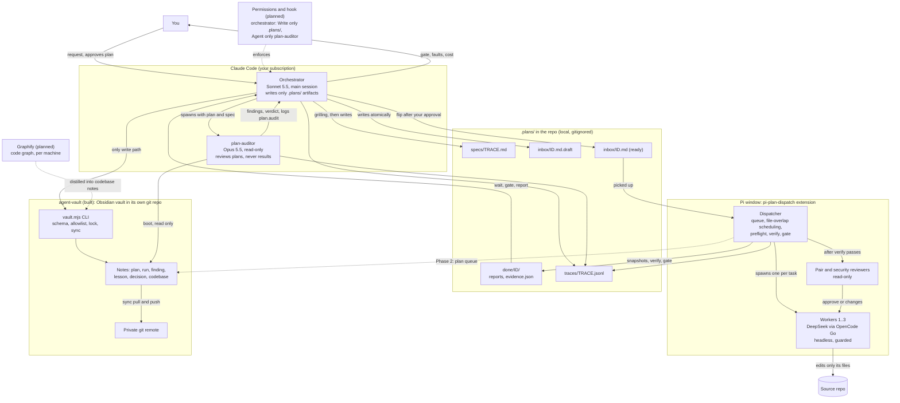
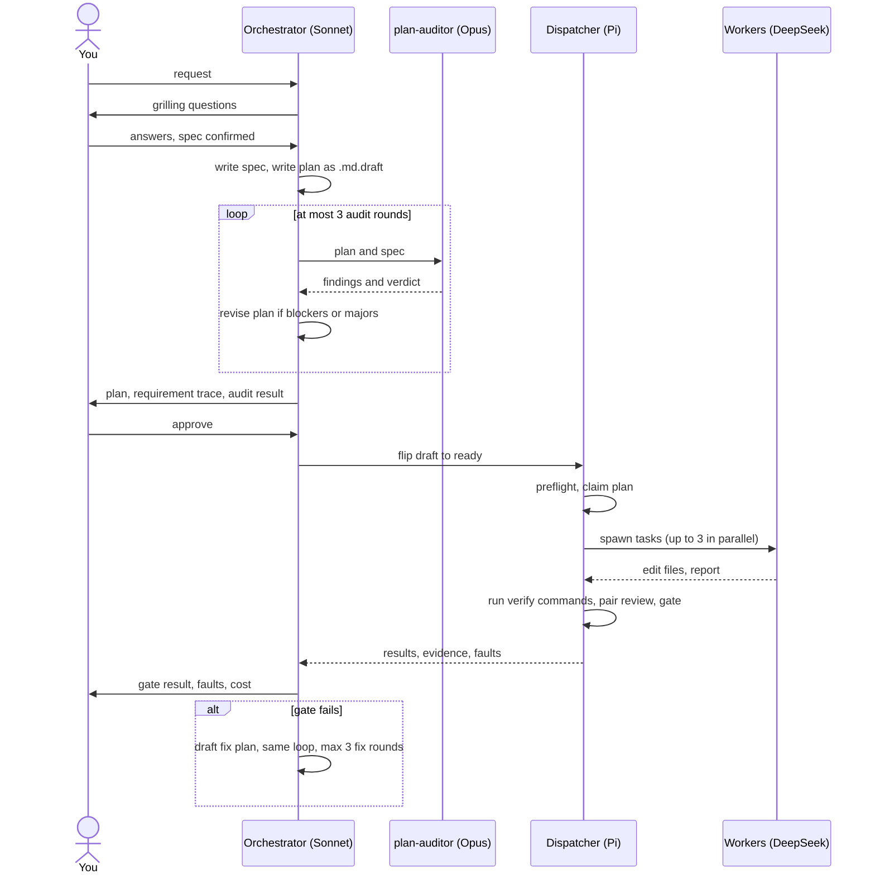

# Architecture

You talk to Sonnet 5.5, the orchestrator, in the main Claude Code session, and it writes plans but never code. Opus 5.5 reviews plans as the read-only `plan-auditor`, cheap Pi workers implement them, files under `.plans/` are the hand-off, and in the diagrams a solid edge is built while a dashed edge is planned.

## Components and data flow

## One request in order

## How to read it

- Three trust levels. The orchestrator plans and approves, the `plan-auditor` checks the plan, and the workers write the code, but the dispatcher does not trust their claims: it re-runs the `verify:` commands, takes git snapshots and the gate decides.
- Files are the hand-off. Nothing talks to anything else directly, except the orchestrator spawning the `plan-auditor`.
- The planned layers. The plan queue, Graphify and the permissions hook are what is left. The vault is built: it is the orchestrator's and the reviewer's memory across machines, and the plan queue on top of it is Phase 2. Graphify feeds code knowledge into it, and the permissions hook makes "the orchestrator may only write under `.plans/`, the vault through the CLI, and spawn the `plan-auditor`" a real capability.

## Built and planned

Built:

- The orchestrator and `plan-auditor` flow.
- The dispatcher, with its queue, file-overlap scheduling and preflight.
- The workers.
- The pair and security reviewers.
- `verify:` commands, the gate, the guards and the traces.
- The preflight CLI.
- The agent-vault: CLI, notes and sync.

Planned:

- Graphify.
- The permissions hook.
- The agent-vault plan queue (Phase 2).
- A web monitor for worker sessions.
